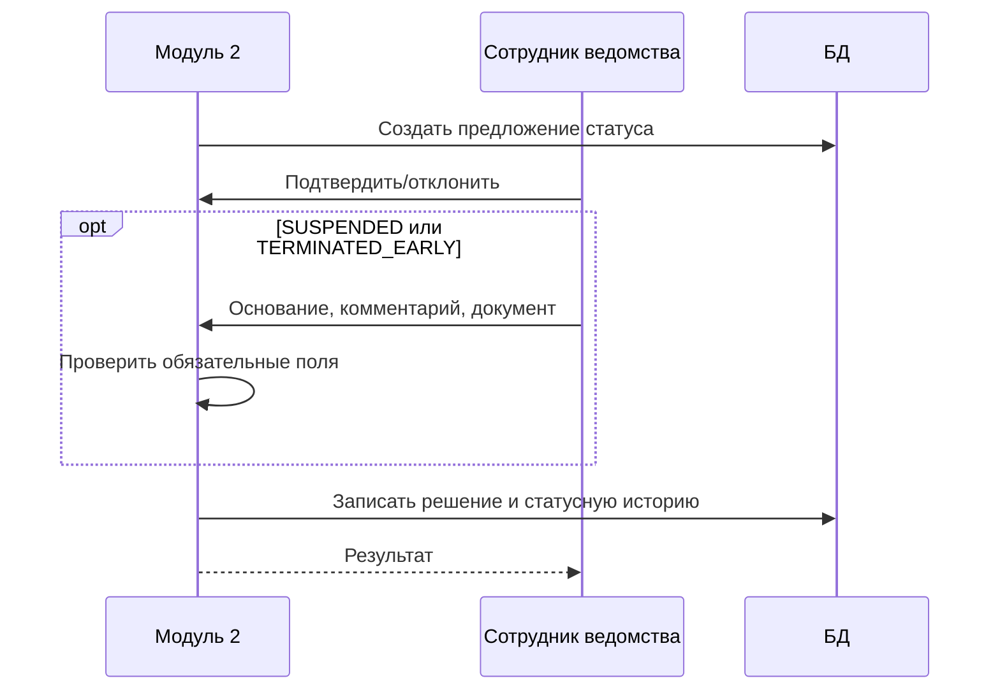

# Диаграмма последовательности

```mermaid
sequenceDiagram
    autonumber
    participant S as Планировщик
    participant M as Модуль 2
    participant X as Внешний API
    participant DB as БД
    participant E as Сотрудник ведомства
    S->>M: Ежедневный запуск
    M->>DB: Создать запись sync_run
    M->>X: Запрос фактических данных
    alt Успех
      X-->>M: Данные
      M->>DB: Сопоставить ID и сохранить snapshot
      M->>M: Рассчитать отклонения
      M->>DB: Записать факты и deviations
    else Ошибка
      loop Три повтора после первой ошибки
        M->>X: Повторный запрос
        X-->>M: Ошибка или данные
      end
      M->>DB: Записать результат; при неуспехе сохранить старые данные и stale
    end
    opt Есть отклонение
      M->>DB: Создать отклонение
      E->>M: Назначить ответственного
      M->>DB: Записать историю и аудит
    end
```


